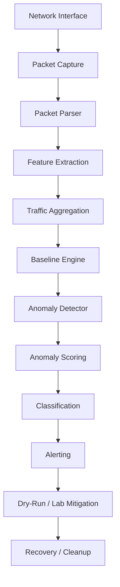

# Distributed DDoS Detection Using Network Traffic Analysis

## 1. Project Title
Distributed DDoS Detection Using Network Traffic Analysis

## 2. Problem Statement
Distributed denial-of-service activity can appear as a coordinated burst of traffic from many sources against a limited set of targets. Detecting such behavior early is important, but the project must remain safe, explainable, and suitable for academic use. This repository focuses on a rule-based, transparent approach that identifies DDoS-like distributed traffic anomalies without claiming every alert is a confirmed attack.

## 3. Objective
The objective is to build a defensively designed, lightweight traffic-analysis project that:
- parses packet-like traffic records
- extracts useful features from traffic windows
- learns a bounded baseline from normal traffic
- identifies suspicious or high-risk distributed traffic patterns
- raises structured alerts
- supports safe simulation and dry-run mitigation
- remains testable and presentation-ready on a normal student workstation

## 4. Architecture
The implementation follows a modular pipeline aligned to the actual project structure.



Actual code modules:
- `src/ddos_detector/config.py` — configuration validation and default settings
- `src/ddos_detector/models.py` — traffic and metric dataclasses
- `src/ddos_detector/packet_parser.py` — packet parsing layer
- `src/ddos_detector/feature_extractor.py` — feature extraction utilities
- `src/ddos_detector/aggregator.py` — bounded aggregation logic
- `src/ddos_detector/baseline.py` — bounded baseline learning
- `src/ddos_detector/detector.py` — explainable multi-indicator detection
- `src/ddos_detector/scoring.py` — anomaly scoring and classification
- `src/ddos_detector/alerts.py` — structured alert creation and bounded history
- `src/ddos_detector/simulator.py` — safe local simulation generation
- `src/ddos_detector/mitigation.py` — dry-run and lab-only mitigation handling
- `src/ddos_detector/recovery.py` — alert and rule recovery tracking
- `src/ddos_detector/main.py` — CLI entrypoint

## 5. Detection Pipeline
1. Collect or simulate packet-like records.
2. Parse and normalize packet fields.
3. Extract per-window features such as packet rate, byte rate, SYN rate, connection attempts, unique source count, and destination concentration.
4. Aggregate traffic into bounded time windows.
5. Compare each new window to a bounded historical baseline.
6. Trigger indicators when traffic patterns significantly exceed the normal baseline.
7. Combine indicator behavior into a transparent anomaly score.
8. Classify the result as `NORMAL`, `SUSPICIOUS`, or `HIGH_RISK`.
9. Emit a structured alert when appropriate.
10. Optionally create a dry-run mitigation record without modifying the host.

## 6. Features
The detector emphasizes explainability rather than opaque black-box inference. Features include:
- packet rate
- byte rate
- TCP/SYN concentration
- connection attempts
- unique source IPs
- destination concentration
- burst intensity
- port distribution

The system detects "DDoS-like distributed traffic anomalies" rather than claiming that every anomaly is definitively an attack.

## 7. Technology Stack
- Python 3.10+
- PyYAML for configuration parsing
- pytest for unit/integration tests
- standard library only for the defensive safety layer
- no frontend, no database, no cloud service, no machine learning model

## 8. Detection Methodology
This is a statistical and rule-based system. It is intentionally transparent and explainable:
- the baseline is learned from prior non-anomalous windows
- multiple indicators must agree before a risky classification is reached
- thresholds are explicit and easy to review
- outputs include quantitative explanations and reasons for decisions

## 9. Anomaly Scoring
The score is computed from indicator deviations and weighted importance. It remains in the `0.0` to `1.0` range conceptually and is classified through explicit thresholds.

- `NORMAL`: traffic remains within expected behavior
- `SUSPICIOUS`: some indicators exceed the learned baseline
- `HIGH_RISK`: multiple indicators strongly suggest a distributed burst pattern

An anomaly means that the observed traffic window differs materially from the
learned statistical baseline; it is not proof that an IP or user is malicious.
HIGH_RISK requires a sufficiently high reproducible score, at least three
triggered indicators, and corroboration from a SYN, connection, or
distributed-source signal. Live monitoring also requires the configured number
of consecutive HIGH_RISK windows (two in the example configuration) before
raising the high-risk classification. This reduces one-window spikes and
packet/byte-only false positives while preserving explainable indicators.

The baseline warms up before classification. Suspicious windows are excluded
from baseline updates, and extreme outliers are rejected from otherwise clean
baseline updates so a sudden spike does not immediately redefine normal
traffic. Legitimate deployment bursts, downloads, health checks, or many
simultaneous clients can still look anomalous; operators should interpret
alerts as behavior requiring attention, not as a definitive attack verdict.

## 10. Simulation
The simulator is intentionally constrained to safe, local-only scenarios.

Allowed targets:
- `localhost`
- `127.0.0.1`
- private IPv4 ranges such as `10.0.0.0/8`, `172.16.0.0/12`, `192.168.0.0/16`
- loopback IPv6 (`::1`)

Rejected targets:
- public internet addresses
- arbitrary external IPs
- URLs or untrusted hostnames

The simulation limits are bounded to prevent accidental high-rate traffic generation.

## 11. Alerting
Alerting is structured and lightweight. Alerts include:
- timestamp
- classification
- score
- severity
- reasons
- current metrics
- baseline context

The system emits console output for suspicious and high-risk events and keeps a bounded alert history.

## 12. Mitigation
Mitigation is intentionally disabled by default.

Safe behavior:
- mitigation is off unless explicitly enabled in config
- live mitigation requires explicit user intent
- dry-run remains the safe default
- public targets are rejected
- Linux firewall tools like `nftables` or `tc` are treated as lab-only features
- host modification is never the default

## 13. Recovery
The recovery layer tracks alert and mitigation states in memory with bounded capacity. It supports:
- alert creation
- rule cleanup
- expired rule removal
- repeated cleanup without crashing

## 14. Safety Restrictions
This project is intentionally constrained to remain safe and academic.

The system does not:
- generate real attack traffic against public targets
- permanently modify host firewall rules by default
- execute arbitrary shell commands from config values
- claim definitive proof of an attack without a broader context

## 15. Installation
From the project root:

```bash
python -m venv .venv
# Windows PowerShell
.\.venv\Scripts\Activate.ps1

pip install -r requirements.txt
pip install -e .
```

The editable install makes `python -m ddos_detector --help` available in the active environment.

## 16. Configuration
The project configuration lives in `config/config.yaml`.

Key defaults include:
- interface: `lo`
- mitigation: disabled by default
- dry-run: enabled by default
- simulation: localhost/private targets only
- thresholds: explicit safe values
- baseline history: bounded

The configuration validator rejects invalid values and clear safety violations.

## 17. CLI Usage
The CLI supports the following commands:

```bash
python -m ddos_detector --help
python -m ddos_detector detect --demo
python -m ddos_detector simulate --mode normal --target 127.0.0.1
python -m ddos_detector simulate --mode distributed --target 10.0.0.5
python -m ddos_detector alert --classification HIGH_RISK --score 0.90 --reason distributed-burst
python -m ddos_detector mitigate --target 127.0.0.1 --interface lo
python -m ddos_detector cleanup --all
```

Command behavior is intentionally clear:
- demo = synthetic local example
- dry-run = no system modification
- live/lab = only if the user explicitly enables it and uses a safe local target

## 18. Testing
Run the test suite with:

```bash
pytest -q
```

The project includes unit tests for:
- configuration validation
- parsing and feature extraction
- aggregation and baseline behavior
- detection thresholds and scoring
- simulation safety
- alert generation
- mitigation safety
- cleanup and recovery
- end-to-end deterministic flow

## 19. Windows Limitations
Windows is used for local development and unit testing.

Supported:
- coding and project validation
- algorithmic testing
- local simulation
- dry-run flows

Not supported by default:
- real Linux firewall and traffic-control integration
- live `nftables` or `tc` execution
- privileged packet capture on native Linux interfaces

## 20. Linux/WSL2 Requirements
Linux or WSL2 is required for the following:
- actual packet capture on a live interface
- `nftables`-based mitigation experiments
- `tc` traffic-control testing
- any real network-level enforcement work

These operations remain explicitly disabled unless configured by the user in a lab environment and verified on Linux/WSL2.

## 21. Example Demo Workflow
A safe demonstration for a college project can look like this:

```bash
python -m ddos_detector detect --demo
python -m ddos_detector simulate --mode normal --target 127.0.0.1
python -m ddos_detector simulate --mode distributed --target 10.0.0.5
python -m ddos_detector alert --classification SUSPICIOUS --score 0.72 --reason distributed-pattern
python -m ddos_detector mitigate --target 127.0.0.1 --interface lo
python -m ddos_detector cleanup --all
```

This demonstrates:
1. normal traffic
2. suspicious traffic
3. distributed high-risk traffic
4. alert generation
5. dry-run mitigation
6. cleanup and recovery

## 22. Project Structure
```text
DDOS/
├── config/
│   └── config.yaml
├── src/
│   └── ddos_detector/
│       ├── __init__.py
│       ├── __main__.py
│       ├── aggregator.py
│       ├── alerts.py
│       ├── baseline.py
│       ├── config.py
│       ├── detector.py
│       ├── feature_extractor.py
│       ├── logging_config.py
│       ├── main.py
│       ├── mitigation.py
│       ├── models.py
│       ├── packet_capture.py
│       ├── packet_parser.py
│       ├── recovery.py
│       ├── scoring.py
│       ├── simulator.py
│       └── __main__.py
├── tests/
│   └── unit/
├── pyproject.toml
├── requirements.txt
├── README.md
├── pytest.ini
└── config.yaml
```

## 23. Limitations
- This is a research/education-oriented detection prototype.
- It does not replace a full production IDS or DDoS defense system.
- It is intentionally rule-based and explainable rather than autonomous or AI-driven.
- Live firewall behavior must be verified separately on Linux/WSL2.

## 24. Future Improvements
Possible future directions include:
- richer packet metadata capture
- more realistic live interface integration
- additional bounded detection indicators
- richer alert export formats
- optional lab-only Linux validation scripts

These are future improvements only; the current project remains intentionally focused on safety and maintainability.

## 25. Final Safety Review
Before use, the project ensures:
- mitigation is disabled by default
- dry-run is the default path
- public targets are rejected
- simulation has hard bounds
- CLI does not execute arbitrary shell commands
- memory and rule history are bounded
- failures are handled gracefully with clear error messages

The design is intentionally defensive and suitable for use as a student project, demonstration, or technical lab exercise.

## 26. WSL2 Localhost Demonstration

This walkthrough is for a controlled localhost/private-lab demonstration only. It must not be used against public or third-party systems.

### Step 1: Enter WSL2

From Windows PowerShell, enter your Linux distribution once:

```powershell
wsl
```

Once inside WSL, do **not** run `wsl` again. The remaining commands are Linux shell commands.

### Step 2: Enter the project directory

Replace the path below with the actual project location:

```bash
cd /path/to/DDOS
```

### Step 3: Verify the environment

```bash
python --version
nft --version
tcpdump --version
```

Use the Linux project interpreter for project execution:

```bash
.venv-linux/bin/python --version
```

### Step 4: Install dependencies

This repository declares runtime and test dependencies in `requirements.txt` and is packaged through `pyproject.toml`. From the project root, use:

```bash
.venv-linux/bin/python -m pip install -r requirements.txt
.venv-linux/bin/python -m pip install -e .
```

### Step 5: Configure Brevo

Copy `.env.example` to `.env` if needed, then set the values locally. `.env.example` contains placeholders only. Never commit `.env` or display its contents.

The supported variable names are:

```text
BREVO_API_KEY
BREVO_SENDER_EMAIL
BREVO_SENDER_NAME
BREVO_ALERT_RECIPIENT
```

Load the environment before starting the monitor with `sudo`:

```bash
set -a
source .env
set +a
```

Verify only whether each variable is set; these commands do not print secret values:

```bash
[ -n "$BREVO_API_KEY" ] && echo "BREVO_API_KEY: SET" || echo "BREVO_API_KEY: NOT SET"
[ -n "$BREVO_SENDER_EMAIL" ] && echo "BREVO_SENDER_EMAIL: SET" || echo "BREVO_SENDER_EMAIL: NOT SET"
[ -n "$BREVO_SENDER_NAME" ] && echo "BREVO_SENDER_NAME: SET" || echo "BREVO_SENDER_NAME: NOT SET"
[ -n "$BREVO_ALERT_RECIPIENT" ] && echo "BREVO_ALERT_RECIPIENT: SET" || echo "BREVO_ALERT_RECIPIENT: NOT SET"
```

The monitor also loads a project-local `.env` next to the repository when it
starts. Existing process variables take precedence, and only the four Brevo
variable names above are read; arbitrary system files are not searched. This
allows the application to find the project credentials when started as root.
The explicit `sudo -E` command below remains useful for preserving exported
variables, but it is not the only supported path. If email is enabled and any
required variable is missing, startup stops with a configuration error naming
the missing variable (never its value). If email is disabled, Brevo variables
are not required.

### Temporary mitigation lifecycle

Live nftables rules are detector-owned temporary rules. Each rule has a
unique ID, creation/expiration timestamps, target, interface, reason, and
active/expired/removed status in the application state. The rule comment is
the exact ownership marker `ddos_detector:<rule-id>`.

The configured `rule_ttl_seconds` is currently enforced by the application;
direct filter rules are not created with an assumed native nftables timeout.
This is intentional because nftables 1.0.9 in the supported WSL environment
does not provide a verified portable timeout form for these rules. New rule
IDs include their expiration epoch, allowing a fresh process to discover and
remove expired detector rules. Run `cleanup --all` after an abnormal shutdown
to remove detector-owned rules safely, or `cleanup` to remove expired rules.
Cleanup lists only the detector table/chain, validates the complete ownership
comment, tolerates already-removed rules, and never flushes or deletes
unrelated firewall objects. Repeating cleanup is safe.

Repeated high-risk behavior uses temporary mitigation rather than permanent
blacklisting. When enabled, the first source/target block uses the configured
initial TTL (60 seconds in the example), later offenses for that same
source/target/interface escalate by the configured factor up to the configured
maximum (300 seconds in the example). An active block is reused rather than
duplicated. New source IPs are tracked independently and the existing
`max_auto_block_sources` limit still applies per detection window.

Offender history is bounded and in-memory only; it expires after
`history_ttl_seconds` and resets on process restart. Active nftables rules
remain detector-owned and discoverable after restart, so cleanup can remove
them safely. Brevo alert cooldown/deduplication remains independent of
mitigation history and prevents repeated identical alert emails within its
configured cooldown.

### Step 6: Clean detector-owned nftables rules

Before a fresh demonstration, remove only mitigation rules owned by this project:

```bash
sudo .venv-linux/bin/python -m ddos_detector cleanup --all
```

Never use a broad nftables ruleset flush command; it can remove unrelated
firewall rules. Use the detector cleanup command above, which removes only
detector-owned rules.

### Step 7: Start the local test server

In a separate WSL terminal, bind the server only to loopback:

```bash
.venv-linux/bin/python -m http.server 18080 --bind 127.0.0.1
```

This creates a local-only HTTP target.

### Step 8: Start the DDoS detector

In another WSL terminal, from the project directory:

```bash
sudo -E .venv-linux/bin/python -m ddos_detector monitor \
  --config config/config.yaml \
  --interface lo
```

The monitor may report:

- `BASELINE_WARMUP`
- `NORMAL`
- `SUSPICIOUS`
- `HIGH_RISK`
- triggered anomaly indicators and score
- alert and mitigation status

### Step 9: Generate controlled localhost demonstration traffic

Run only this bounded loop against the local server:

```bash
for i in $(seq 1 100); do
    curl -s --max-time 2 http://127.0.0.1:18080/ > /dev/null &
done
wait
```

This is **controlled localhost demonstration traffic**. Do not substitute a public address, external hostname, or third-party target.

### Step 10: Inspect detector-owned nftables rules

```bash
sudo nft -a list table inet ddos_detector
```

During a configured `HIGH_RISK` response, a temporary detector-owned rule may look like:

```text
ip saddr 127.0.0.1 ip daddr 127.0.0.1 iifname "lo" drop comment "ddos_detector:source-live-..."
```

The rule ID and handle are generated at runtime; do not assume a particular value.

### Step 11: Verify recovery

After the bounded traffic stops, allow subsequent windows to process. The monitor should return toward:

```text
classification: NORMAL
```

This demonstrates recovery after the abnormal localhost window.

### Step 12: Stop the monitor

Return to the monitor terminal and press:

```text
Ctrl+C
```

Stop the temporary HTTP server with `Ctrl+C` in its terminal as well.

### Step 13: Clean detector-owned nftables rules

```bash
sudo .venv-linux/bin/python -m ddos_detector cleanup --all
sudo nft -a list table inet ddos_detector
```

Cleanup removes detector-owned mitigation rules only. It does not flush unrelated nftables rules.

### Step 14: Run the test suite

```bash
.venv-linux/bin/python -m pytest -q
```
