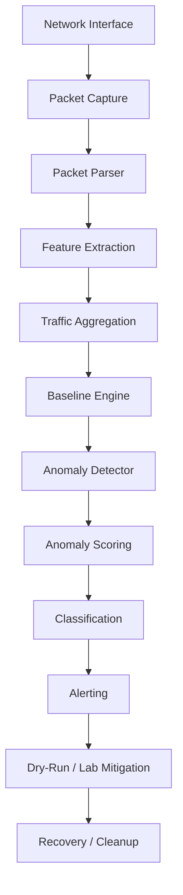

# Distributed DDoS Detection Using Network Traffic Analysis

## 1. Project Title
Distributed DDoS Detection Using Network Traffic Analysis

## 2. Problem Statement
Distributed denial-of-service activity can appear as a coordinated burst of traffic from many sources against a limited set of targets. Detecting such behavior early is important, but the project must remain safe, explainable, and suitable for academic use. This repository focuses on a rule-based, transparent approach that identifies DDoS-like distributed traffic anomalies without claiming every alert is a confirmed attack.

## 3. Objective
The objective is to build a defensively designed, lightweight traffic-analysis project that:
- parses packet-like traffic records
- extracts useful features from traffic windows
- learns a bounded baseline from normal traffic
- identifies suspicious or high-risk distributed traffic patterns
- raises structured alerts
- supports safe simulation and dry-run mitigation
- remains testable and presentation-ready on a normal student workstation

## 4. Architecture
The implementation follows a modular pipeline aligned to the actual project structure.



Actual code modules:
- `src/ddos_detector/config.py` — configuration validation and default settings
- `src/ddos_detector/models.py` — traffic and metric dataclasses
- `src/ddos_detector/packet_parser.py` — packet parsing layer
- `src/ddos_detector/feature_extractor.py` — feature extraction utilities
- `src/ddos_detector/aggregator.py` — bounded aggregation logic
- `src/ddos_detector/baseline.py` — bounded baseline learning
- `src/ddos_detector/detector.py` — explainable multi-indicator detection
- `src/ddos_detector/scoring.py` — anomaly scoring and classification
- `src/ddos_detector/alerts.py` — structured alert creation and bounded history
- `src/ddos_detector/simulator.py` — safe local simulation generation
- `src/ddos_detector/mitigation.py` — dry-run and lab-only mitigation handling
- `src/ddos_detector/recovery.py` — alert and rule recovery tracking
- `src/ddos_detector/main.py` — CLI entrypoint

## 5. Detection Pipeline
1. Collect or simulate packet-like records.
2. Parse and normalize packet fields.
3. Extract per-window features such as packet rate, byte rate, SYN rate, connection attempts, unique source count, and destination concentration.
4. Aggregate traffic into bounded time windows.
5. Compare each new window to a bounded historical baseline.
6. Trigger indicators when traffic patterns significantly exceed the normal baseline.
7. Combine indicator behavior into a transparent anomaly score.
8. Classify the result as `NORMAL`, `SUSPICIOUS`, or `HIGH_RISK`.
9. Emit a structured alert when appropriate.
10. Optionally create a dry-run mitigation record without modifying the host.

## 6. Features
The detector emphasizes explainability rather than opaque black-box inference. Features include:
- packet rate
- byte rate
- TCP/SYN concentration
- connection attempts
- unique source IPs
- destination concentration
- burst intensity
- port distribution

The system detects "DDoS-like distributed traffic anomalies" rather than claiming that every anomaly is definitively an attack.

## 7. Technology Stack
- Python 3.10+
- Scapy for Linux packet capture and parsing
- PyYAML for configuration parsing
- Requests for Brevo alert delivery
- pytest for unit/integration tests
- no frontend, no database, no cloud service, no machine learning model

## 8. Detection Methodology
This is a statistical and rule-based system. It is intentionally transparent and explainable:
- the baseline is learned from prior non-anomalous windows
- multiple indicators must agree before a risky classification is reached
- thresholds are explicit and easy to review
- outputs include quantitative explanations and reasons for decisions

## 9. Anomaly Scoring
The score is computed from indicator deviations and weighted importance. It remains in the `0.0` to `1.0` range conceptually and is classified through explicit thresholds.

- `NORMAL`: traffic remains within expected behavior
- `SUSPICIOUS`: some indicators exceed the learned baseline
- `HIGH_RISK`: multiple indicators strongly suggest a distributed burst pattern

An anomaly means that the observed traffic window differs materially from the
learned statistical baseline; it is not proof that an IP or user is malicious.
HIGH_RISK requires a sufficiently high reproducible score, at least three
triggered indicators, and corroboration from a SYN, connection, or
distributed-source signal. Live monitoring also requires the configured number
of consecutive HIGH_RISK windows (one in the committed example configuration) before
raising the high-risk classification. This reduces one-window spikes and
packet/byte-only false positives while preserving explainable indicators.

Live monitoring begins in an explicit `BASELINE_WARMUP` state; it does not
classify traffic as `NORMAL` or use the first packet-bearing window as a
baseline. Bootstrap requires three valid observation windows.
Their metrics are compared with the per-feature median using a deterministic
outlier bound: the larger of six median absolute deviations or 25% of the
median's magnitude (with a minimum tolerance of 0.25). At least two of the
three observations must agree to seed the baseline; rejected observations
cannot contribute to it. Later bootstrap windows must remain within the same
robust bounds of the accepted samples, and the detector stays in warm-up until
`baseline.minimum_samples` trustworthy windows have been collected. Empty,
all-zero windows are valid observations; malformed, negative, non-finite, or
structurally inconsistent metrics are rejected. After warm-up, only windows
classified `NORMAL` are offered to the baseline, and extreme outliers are
rejected by the baseline engine.

This screening reduces the influence of isolated startup spikes, but no
statistical method can distinguish a sustained attack from legitimate traffic
when no trusted reference exists. During cold start, a sustained and internally
consistent burst may still resemble normal traffic; monitoring does not claim
to detect every attack before a trusted baseline is available. Each
metric is calculated over `[boundary - window_seconds, boundary)` and emitted
every `slide_seconds` using monotonic arrival times. Sliding metrics overlap
intentionally and must not be summed. Legitimate deployment bursts, downloads, health checks, or many
simultaneous clients can still look anomalous; operators should interpret
alerts as behavior requiring attention, not as a definitive attack verdict.

## 10. Simulation
The simulator is intentionally constrained to safe, local-only scenarios.

Allowed targets:
- `localhost`
- `127.0.0.1`
- private IPv4 ranges such as `10.0.0.0/8`, `172.16.0.0/12`, `192.168.0.0/16`
- loopback IPv6 (`::1`)

Rejected targets:
- public internet addresses
- arbitrary external IPs
- URLs or untrusted hostnames

Simulation creates synthetic metric records only. It opens no sockets and sends
no network traffic; its limits bound the synthetic values and source counts.

## 11. Alerting
Alerting is structured and lightweight. Alerts include:
- timestamp
- classification
- score
- severity
- reasons
- current metrics
- baseline context

The system emits console output for suspicious and high-risk events and keeps a bounded alert history.

## 12. Mitigation
Mitigation is intentionally disabled by default.

Safe behavior:
- mitigation is off unless explicitly enabled in config
- live mitigation requires explicit user intent
- dry-run remains the safe default
- public targets are rejected
- Linux firewall tools like `nftables` or `tc` are treated as lab-only features
- host modification is never the default

## 13. Recovery
Runtime alert incidents are re-armed after the configured number of
consecutive `NORMAL` windows. Mitigation records track rule ownership and
expiration, and cleanup targets only detector-owned rules. `RecoveryTracker`
in `recovery.py` remains a standalone compatibility utility and is not wired
into the live incident lifecycle.

## 14. Safety Restrictions
This project is intentionally constrained to remain safe and academic.

The system does not:
- generate real attack traffic against public targets
- permanently modify host firewall rules by default
- execute arbitrary shell commands from config values
- claim definitive proof of an attack without a broader context

## 15. Installation
Windows supports development, tests, synthetic simulation, and dry-run flows.
Live packet capture is Linux/WSL2-only, and live nftables enforcement is
Linux-only.

Windows PowerShell:

```bash
python -m venv .venv
.\.venv\Scripts\Activate.ps1
python -m pip install -e ".[test]"
```

Linux/WSL2 (Python 3.12 is the tested live-capture environment):

```bash
python3 -m venv .venv-linux
source .venv-linux/bin/activate
python -m pip install -e ".[test]"
```

`python -m pip install -r requirements.txt` is also available for environments
that prefer the flat dependency list. The editable install enables
`python -m ddos_detector --help`. Native Windows does not support live Linux
packet capture or nftables enforcement.

## 16. Configuration
The project configuration lives in `config/config.yaml`.

Key defaults include:
- interface: `lo`
- mitigation: disabled by default
- dry-run: enabled by default
- simulation: localhost/private targets only
- thresholds: explicit safe values
- baseline history: bounded

The configuration validator rejects invalid values and clear safety violations.

## 17. CLI Usage
The CLI supports the following commands:

```bash
python -m ddos_detector --help
python -m ddos_detector detect --demo
python -m ddos_detector simulate --mode normal --target 127.0.0.1
python -m ddos_detector simulate --mode distributed --target 10.0.0.5
python -m ddos_detector alert --classification HIGH_RISK --score 0.90 --reason distributed-burst
python -m ddos_detector mitigate --target 127.0.0.1 --interface lo
python -m ddos_detector cleanup --all
```

`simulate` prints synthetic metrics; it does not transmit traffic. `alert` can
send email when Brevo delivery is enabled and correctly configured, so disable
`alerts.email.enabled` when demonstrating alert formatting without delivery.
Mitigation is disabled in the committed configuration; dry-run creates only an
in-memory record when explicitly enabled. Live enforcement requires an explicit
`mitigation.enabled: true` and `mitigation.dry_run: false` configuration and is
supported only inside an isolated Linux namespace/veth lab.

## 18. Testing
Run the test suite with:

```bash
pytest -q
```

The project includes unit tests for:
- configuration validation
- parsing and feature extraction
- aggregation and baseline behavior
- detection thresholds and scoring
- simulation safety
- alert generation
- mitigation safety
- cleanup and recovery
- end-to-end deterministic flow

## 19. Windows Limitations
Windows is supported for development and unit testing when dependencies install.

Supported:
- coding and project validation
- algorithmic testing
- synthetic simulation (no network traffic)
- dry-run mitigation flows

Not supported:
- live packet capture
- Linux `nftables` or `tc` enforcement

## 20. Linux/WSL2 Requirements
Linux/WSL2 is required for live packet capture. Live `nftables` enforcement is
Linux-only (including WSL2 installations that provide the required namespace
and firewall capabilities); Windows does not provide either Linux feature.
Live enforcement demonstrations must use an isolated Linux network namespace
connected by a veth pair, not the host network, loopback, or a shared/NAT
address. Packet parsing and live capture currently support IPv4 only; IPv6
traffic is not monitored or enforced.

Detection produces classifications and metrics. Alerting writes console and
structured alerts, with optional Brevo delivery when explicitly configured.
Kernel enforcement is a separate, opt-in action and requires both
`mitigation.enabled: true` and `mitigation.dry_run: false`.

## 21. Example Demo Workflow
A safe, non-networked demonstration uses synthetic metrics:

```bash
python -m ddos_detector detect --demo
python -m ddos_detector simulate --mode normal --target 127.0.0.1
python -m ddos_detector simulate --mode distributed --target 10.0.0.5
```

These commands do not generate or capture network traffic and do not send
email. Use the dry-run example below to exercise mitigation without changing
the host. `alert` can deliver a real Brevo email if email delivery is enabled;
do not use that command for a no-email demonstration unless email is disabled
in the selected configuration.

## 22. Project Structure
```text
DDOS/
├── config/
│   └── config.yaml
├── src/
│   └── ddos_detector/
│       ├── __init__.py
│       ├── aggregator.py
│       ├── alerts.py
│       ├── baseline.py
│       ├── config.py
│       ├── detector.py
│       ├── feature_extractor.py
│       ├── logging_config.py
│       ├── main.py
│       ├── mitigation.py
│       ├── models.py
│       ├── packet_capture.py
│       ├── packet_parser.py
│       ├── recovery.py
│       ├── scoring.py
│       ├── simulator.py
│       └── __main__.py
├── tests/
│   └── unit/
├── pyproject.toml
├── requirements.txt
├── pytest.ini
└── README.md
```

## 23. Limitations
- This is a research/education-oriented detection prototype.
- It does not replace a full production IDS or DDoS defense system.
- It is intentionally rule-based and explainable rather than autonomous or AI-driven.
- Live firewall behavior must be verified separately on Linux/WSL2.

## 24. Future Improvements
Possible future directions include:
- richer packet metadata capture
- more realistic live interface integration
- additional bounded detection indicators
- richer alert export formats
- optional lab-only Linux validation scripts

These are future improvements only; the current project remains intentionally focused on safety and maintainability.

## 25. Final Safety Review
Before use, the project ensures:
- mitigation is disabled by default
- dry-run is the default path
- public targets are rejected
- simulation has hard bounds
- CLI does not execute arbitrary shell commands
- memory and rule history are bounded
- failures are handled gracefully with clear error messages

The design is intentionally defensive and suitable for use as a student project, demonstration, or technical lab exercise.

## 26. Safe demonstrations and isolated live lab

This walkthrough is for a controlled localhost/private-lab demonstration only. It must not be used against public or third-party systems.

### Step 1: Enter WSL2

From Windows PowerShell, enter your Linux distribution once:

```powershell
wsl
```

Once inside WSL, do **not** run `wsl` again. The remaining commands are Linux shell commands.

### Step 2: Enter the project directory

Replace the path below with the actual project location:

```bash
cd /path/to/DDOS
```

### Verify the Linux environment

```bash
python --version
nft --version
ip -Version
```

Use the Linux project interpreter for project execution:

```bash
.venv-linux/bin/python --version
```

### Install dependencies

From the project root, install runtime and test dependencies with:

```bash
.venv-linux/bin/python -m pip install -e ".[test]"
```

### Step 5: Configure Brevo

Copy `.env.example` to `.env` if needed, then set the values locally. `.env.example` contains placeholders only. Never commit `.env` or display its contents.

The supported variable names are:

```text
BREVO_API_KEY
BREVO_SENDER_EMAIL
BREVO_SENDER_NAME
BREVO_ALERT_RECIPIENT
```

Load the environment before starting the monitor with `sudo`:

```bash
set -a
source .env
set +a
```

Verify only whether each variable is set; these commands do not print secret values:

```bash
[ -n "$BREVO_API_KEY" ] && echo "BREVO_API_KEY: SET" || echo "BREVO_API_KEY: NOT SET"
[ -n "$BREVO_SENDER_EMAIL" ] && echo "BREVO_SENDER_EMAIL: SET" || echo "BREVO_SENDER_EMAIL: NOT SET"
[ -n "$BREVO_SENDER_NAME" ] && echo "BREVO_SENDER_NAME: SET" || echo "BREVO_SENDER_NAME: NOT SET"
[ -n "$BREVO_ALERT_RECIPIENT" ] && echo "BREVO_ALERT_RECIPIENT: SET" || echo "BREVO_ALERT_RECIPIENT: NOT SET"
```

The monitor also loads a project-local `.env` next to the repository when it
starts. Existing process variables take precedence, and only the four Brevo
variable names above are read; arbitrary system files are not searched. This
allows the application to find the project credentials when started as root.
`sudo -E` preserves exported variables, but the application also loads only
these supported names from the project-local `.env`. Missing Brevo values are
reported as a configuration warning; email delivery is optional and disabled
in the programmatic defaults. Do not run email-enabled demonstrations unless
you intend to deliver a real email.

### Temporary mitigation lifecycle

Live nftables rules are detector-owned temporary rules. Each rule has a
unique ID, creation/expiration timestamps, target, interface, reason, and
active/expired/removed status in the application state. The rule comment is
the exact ownership marker `ddos_detector:<rule-id>`.

The configured `rule_ttl_seconds` is currently enforced by the application;
direct filter rules are not created with an assumed native nftables timeout.
This is intentional because nftables 1.0.9 in the supported WSL environment
does not provide a verified portable timeout form for these rules. New rule
IDs include their expiration epoch, allowing a fresh process to discover and
remove expired detector rules. Run `cleanup --all` after an abnormal shutdown
to remove detector-owned rules safely, or `cleanup` to remove expired rules.
Cleanup lists only the detector table/chain, validates the complete ownership
comment, tolerates already-removed rules, and never flushes or deletes
unrelated firewall objects. Repeating cleanup is safe.

Repeated high-risk behavior uses temporary mitigation rather than permanent
blacklisting. When enabled, the first source/target block uses the configured
initial TTL (60 seconds in the example), later offenses for that same
source/target/interface escalate by the configured factor up to the configured
maximum (300 seconds in the example). An active block is reused rather than
duplicated. New source IPs are tracked independently and the existing
`max_auto_block_sources` limit still applies per detection window.

Offender history is bounded and in-memory only; it expires after
`history_ttl_seconds` and resets on process restart. Active nftables rules
remain detector-owned and discoverable after restart, so cleanup can remove
them safely. Brevo alert cooldown/deduplication remains independent of
mitigation history. Alert incident state is process-local: separate detector
processes and process restarts do not share notification deduplication state,
so a restarted or concurrently launched process can send a duplicate incident
notification. Persistent cross-process incident state is not implemented.

### Phase 2 validation evidence

`scripts/measure_monitor.py` is a bounded, synthetic-only benchmark. Run it
from Linux/WSL2 with:

```bash
.venv-linux/bin/python scripts/measure_monitor.py
```

It injects a 5 packets/s normal phase, a 50 packets/s two-second synthetic
burst, and another 5 packets/s normal phase into the monitor's bounded queue.
It opens no packet-capture socket, transmits no packets, and uses dry-run
mitigation. One recorded WSL2 run (Linux
`6.6.87.2-microsoft-standard-WSL2`, Python 3.12.3) lasted 21.804 seconds and
reported 0.088 seconds process CPU (0.40% of one core), RSS from 70,992 to
71,120 KiB, 202/202 injected records processed, no synthetic queue drops,
1.201 seconds to HIGH_RISK, 2.2 seconds to the second NORMAL scoring window,
and 11.01 scheduled cleanup calls/minute (excluding startup/shutdown).
This is a single low-rate Python processing-loop measurement, not a Scapy/NIC
capture benchmark or a throughput claim. Re-run the script to collect results
for the local environment.

No live nftables integration test was run as part of this validation; kernel
enforcement remains **NOT VERIFIED**. Synthetic pipeline tests do not provide
labelled research data, so precision, recall, F1, false-positive rate, and
real-network detection performance remain unmeasured.

### Dry-run localhost demonstration

The simulator produces synthetic metrics; it does not transmit packets.
Exercise the localhost mitigation path without changing host firewall state
using an explicit temporary dry-run configuration:

```bash
cat > /tmp/ddos-detector-dry-run.yaml <<'YAML'
mitigation:
  enabled: true
  dry_run: true
  mechanism: nftables
YAML

.venv-linux/bin/python -m ddos_detector simulate --mode normal --target 127.0.0.1
.venv-linux/bin/python -m ddos_detector mitigate \
  --config /tmp/ddos-detector-dry-run.yaml \
  --target 127.0.0.1 --interface lo
rm /tmp/ddos-detector-dry-run.yaml
```

The mitigation action only creates an in-memory dry-run record. Do not use
localhost or loopback for a live enforcement test.

### Live enforcement: isolated namespace/veth lab only

Live enforcement is Linux-only and requires root/CAP_NET_ADMIN privileges,
`iproute2`, and `nftables`. Keep the lab isolated: create two namespaces with
no routes, bridges, forwarding, or connection to external networks.

```bash
sudo ip netns add ddos-sensor
sudo ip netns add ddos-target
sudo ip link add ddos-veth0 type veth peer name ddos-veth1
sudo ip link set ddos-veth0 netns ddos-sensor
sudo ip link set ddos-veth1 netns ddos-target
sudo ip -n ddos-sensor addr add 10.254.0.1/30 dev ddos-veth0
sudo ip -n ddos-target addr add 10.254.0.2/30 dev ddos-veth1
sudo ip -n ddos-sensor link set lo up
sudo ip -n ddos-target link set lo up
sudo ip -n ddos-sensor link set ddos-veth0 up
sudo ip -n ddos-target link set ddos-veth1 up
```

Create a separate, temporary live config only for this lab. Live enforcement
requires both explicit settings. Automatic source blocking remains off unless
separately enabled with explicit attribution:

```bash
cat > /tmp/ddos-detector-live-lab.yaml <<'YAML'
mitigation:
  enabled: true
  dry_run: false
  mechanism: nftables
  rule_ttl_seconds: 30
YAML
```

The following direct action installs a detector-owned rule inside the sensor
namespace for its own veth address. It may disrupt traffic to that address:

```bash
sudo ip netns exec ddos-sensor .venv-linux/bin/python -m ddos_detector mitigate \
  --config /tmp/ddos-detector-live-lab.yaml \
  --target 10.254.0.1 --interface ddos-veth0
sudo ip netns exec ddos-sensor nft -a list table inet ddos_detector
```

Clean detector-owned rules before deleting the namespaces. Confirm any cleanup
error rather than assuming a rule was removed:

```bash
sudo ip netns exec ddos-sensor .venv-linux/bin/python -m ddos_detector cleanup --all
sudo ip netns del ddos-sensor
sudo ip netns del ddos-target
rm /tmp/ddos-detector-live-lab.yaml
```

Never flush an nftables ruleset or remove rules not owned by this application.
Detection, optional alert delivery, and kernel enforcement are separate:
a classification does not itself imply an email or a DROP rule. Live capture
and packet parsing currently support IPv4 only; IPv6 is unsupported.

Run tests with:

```bash
.venv-linux/bin/python -m pytest -q
```
